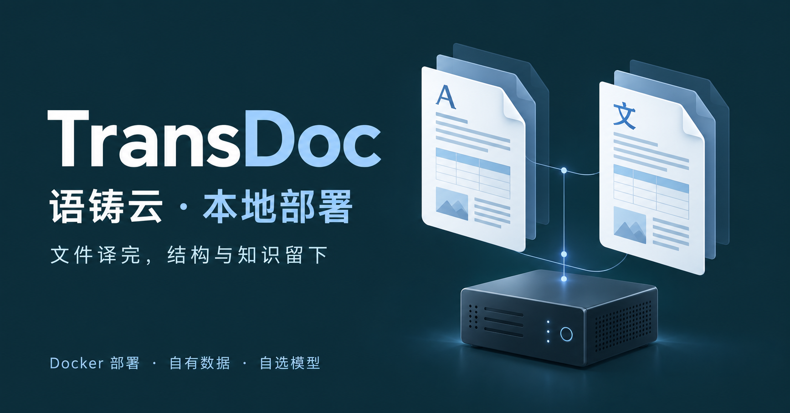

# 语铸云 TransDoc · 本地部署版

把文件翻译、格式还原、术语和翻译记忆放在自己的电脑或服务器上。

[下载发行包](https://github.com/70451136/TransDoc/releases) · [安装说明](INSTALL.md) · [常见问题](FAQ.md) · [官网](https://doc.abcfanyi.com)

这是 **Docker 独立部署版的发行仓库**，不是主站源码仓库。仓库仅提供安装脚本、Compose、使用文档及发行附件；业务源码不在此仓库公开。上方为品牌插画，不是应用截图。

当前为 **0.2.1-r11 预发布测试版**。请先阅读 [版本说明、验证范围及已知安全告警](RELEASE-NOTES.md)。

## 核心能力

- **文件翻译与交付**：Office 文档结构解析、标签与占位符保护、格式写回，支持译文和原译对照交付。复杂排版和重要内容仍建议人工复核。
- **翻译 QA**：检查漏译、术语、数字和一致性；支持 Trados / SDLXLIFF 等双语文件检查。
- **客户知识资产**：客户、项目、术语和翻译记忆关联使用；共享与协作受资源权限控制，支持模板、导入和导出。
- **可观测任务**：查看 Agent 阶段、模型调用、并发和重试记录；保留已完成段落，在可确认的边界内恢复任务，不把未知计费当成免费重试。
- **自选模型**：使用自己的云服务商密钥、自定义兼容端点，或接入 Ollama、LM Studio、vLLM。安装包不附带模型或第三方额度。
- **独立运行**：自有 PostgreSQL、Redis、文件存储、账号及模型配置，不复制主站用户或数据。

## 开始使用

| 环境 | 下载与启动 |
| --- | --- |
| Windows 10/11 x64 | 下载 Windows ZIP，完整解压，双击 `Start.cmd`，按菜单一键继续 |
| Linux x86_64 | 下载 Linux Docker 包，按 [安装说明](INSTALL.md) 准备环境和激活 |
| 自有云服务器 | 使用相同 Linux 包，另行配置域名、HTTPS、访问控制和备份 |

安装器负责数据库与 Redis、随机密码、迁移、健康检查和服务启动。默认工作台只监听本机 `127.0.0.1:8080`，不会发布数据库端口。不要只运行一个 API 镜像，也不要把开发 Compose 当成发行配置。

发布镜像：`transdoc520/transdoc-runtime`、`transdoc520/transdoc-web`。两者必须来自同一发行版本；安装包使用真实 SHA256 摘要固定镜像。当前目标为 `linux/amd64`；Windows 通过 Docker Desktop 的 Linux 容器运行，不是 Windows 容器，也未承诺 ARM64 支持。

## 免费与授权

本地部署版可免费下载安装，默认永久授权没有商业到期日；仍需要定期向授权中心校验。有效签名可在断网后继续使用最多 7 天，已知到期或停用仍按授权状态执行。受限时保留已有文件查看和下载，不启动新的受限处理。

**永久免费不等于所有费用都免费**：第三方模型、云主机、存储、网络及 Docker Desktop 可能有各自费用和条款。本地模型也需自行准备算力。正式使用前请阅读 [隐私与安全边界](SECURITY.md)。

## 更新与反馈

升级前备份配置、数据库和文件卷。重复安装应复用原目录和身份；不要删除 `config/` 或执行 `docker compose down -v`。Windows 菜单提供保留数据的修复/重装。

通过 [Issues](https://github.com/70451136/TransDoc/issues) 提交系统、发行版本和脱敏错误码，不要上传客户原文、密码、授权文件、模型密钥或完整日志。

### English

TransDoc is a self-hosted document translation and QA workspace. This repository distributes Docker installers and documentation, **not the proprietary application source**. Run the full release stack with PostgreSQL and Redis; bring your own hosted-model credentials or local endpoint. The default perpetual grant has no commercial expiry but requires periodic validation, with a signed offline grace of up to seven days. Third-party services and infrastructure are not included. See [installation](INSTALL.md) and [security](SECURITY.md).
